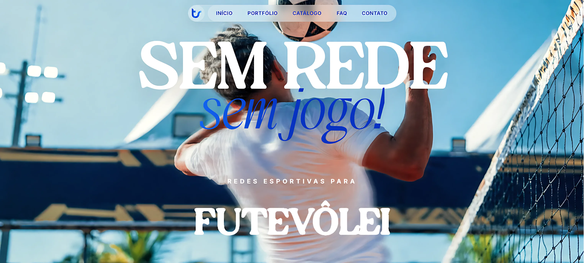

# Toinho Redes — Sem Rede, Sem Jogo! 🏆



Uma landing page moderna e interativa desenvolvida para a **Toinho Redes**, destacando a fabricação de redes esportivas personalizadas e de alto desempenho utilizadas nas praias, quadras e eventos mais importantes da Bahia.

---

## 🏖️ Sobre a Toinho Redes

A **Toinho Redes** é líder absoluta em redes esportivas de alta performance em todo o território baiano. Com tradição e foco em qualidade, a marca atende desde entusiastas do esporte até atletas profissionais e campeonatos nacionais.

### 🌟 Destaques da Marca:
* **+10 anos** de tradição e experiência no mercado esportivo.
* **+930 quadras** equipadas em todo o país.
* **+200 eventos** patrocinados e apoiados.
* **Sob Medida:** Redes confeccionadas sob medida de acordo com as necessidades específicas da sua quadra ou espaço esportivo.
* **Esportes Atendidos:** Futevôlei, Beach Tennis, Vôlei e Tênis.

---

## 🛠️ Especificações Técnicas (Para desenvolvedores)

### Stacks Utilizadas:
* **[React](https://react.dev/)** + **[TypeScript](https://www.typescriptlang.org/)** 
* **[Vite](https://vitejs.dev/)** 
* **[Tailwind CSS](https://tailwindcss.com/)** 
* **[Framer Motion](https://www.framer.com/motion/)**
* **[GSAP](https://gsap.com/)**
* **[Lenis](https://lenis.darkroom.engineering/)**
* **[Lucide React](https://lucide.dev/)** & **[React Icons](https://react-icons.github.io/react-icons/)**
* **[tsparticles](https://particles.js.org/)**

---

## 🚀 Desenvolvimento

```bash
npm install
npm run dev        # http://localhost:5173
npm run build      # type-check + build de produção em /dist
npm run preview    # serve o build localmente
```

## 🖼️ Imagens

Todas as imagens do site são servidas do próprio domínio (nada de hotlink).
Os originais pesados ficam em `assets-src/` (ignorado pelo git) e o script abaixo gera os WebP otimizados em `public/`:

```bash
npm run optimize:images          # só gera o que falta
npm run optimize:images -- --force
```

Para trocar/adicionar uma foto: coloque o original em `assets-src/`, registre no `scripts/optimize-images.mjs` e rode o comando.

## ☁️ Deploy no Netlify

O projeto já está configurado via [`netlify.toml`](./netlify.toml) (build, Node 20, cache e headers de segurança).

1. Netlify → **Add new site → Import an existing project** → escolha o repositório.
2. As configurações são lidas do `netlify.toml` automaticamente:
   * **Build command:** `npm run build`
   * **Publish directory:** `dist`
3. Cada `git push` na branch principal gera um novo deploy.

> Depois de definir o domínio final, atualize `og:image` no `index.html` para a URL absoluta (ex.: `https://seudominio.com/4faixas.webp`) para o preview correto no WhatsApp/Instagram.

---
